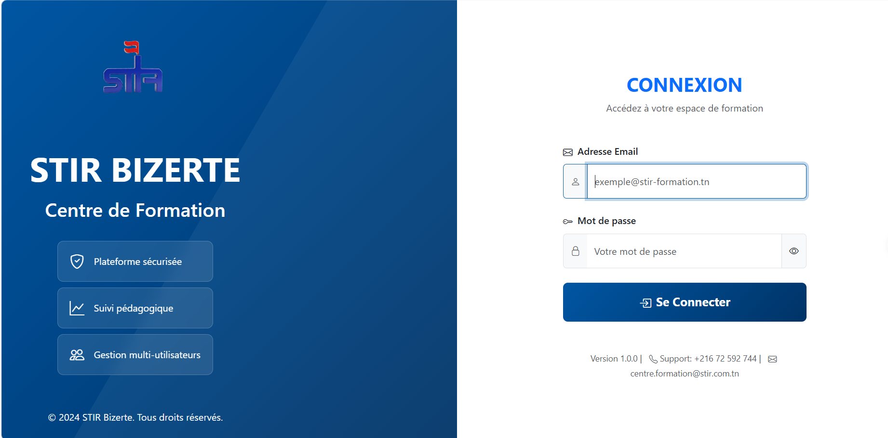
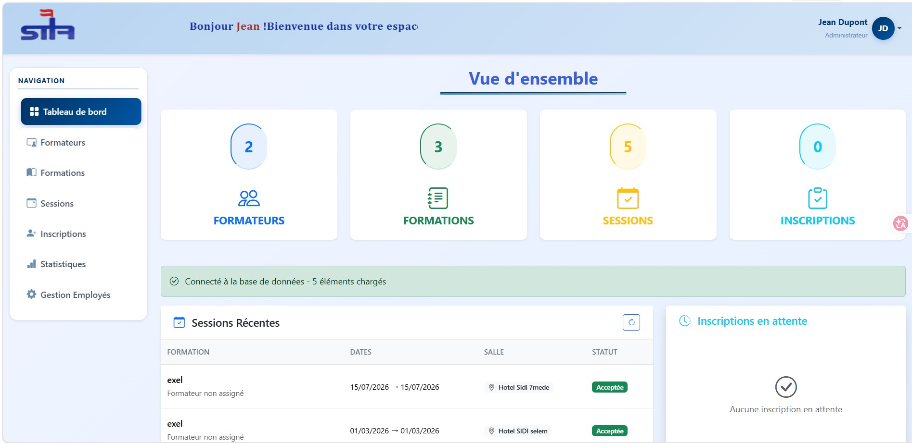
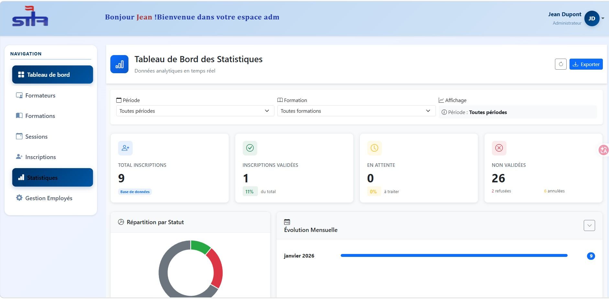
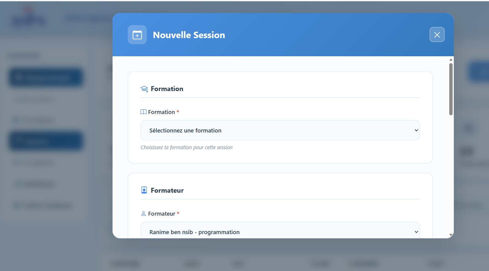
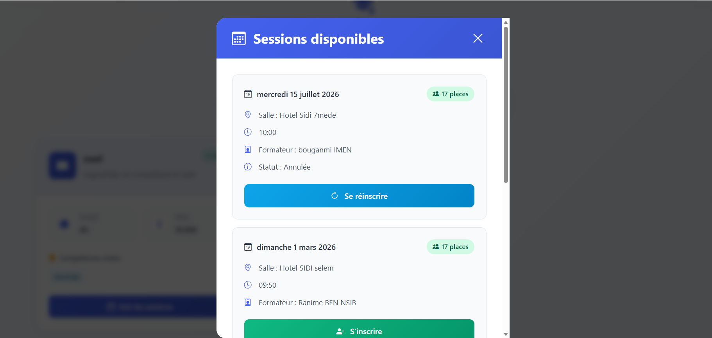
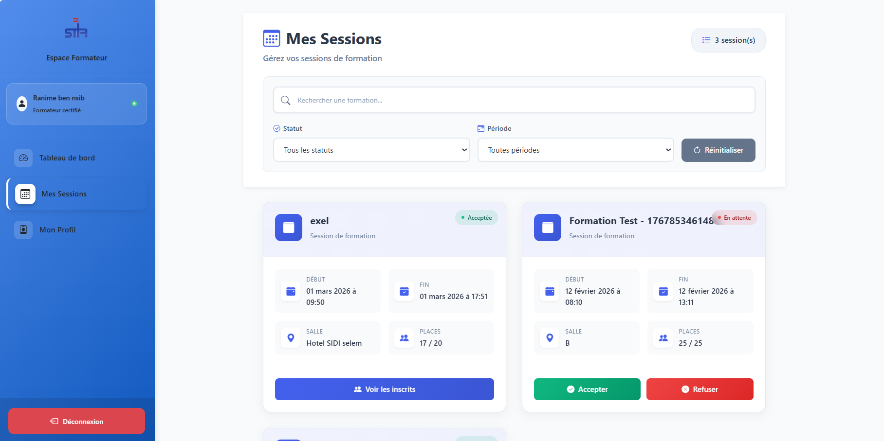

# Centre de Formation

Application web de gestion des formations d'un centre de formation interne : catalogue de formations, sessions, inscriptions des employés, affectation des formateurs et statistiques. Elle propose trois espaces selon le profil de l'utilisateur : **administrateur**, **formateur** et **employé**.

> Projet réalisé dans le cadre de mon stage de perfectionnement au sein de STIR.

## Captures d'écran

| Connexion | Tableau de bord administrateur |
|---|---|
|  |  |

| Statistiques (admin) | Création d'une session (admin) |
|---|---|
|  |  |

| Accueil employé | Inscription à une formation (employé) |
|---|---|
|  |  |

| Espace formateur |
|---|
|  |

## Fonctionnalités

### Administrateur
- Gestion des **formations** (création, modification, suppression)
- Gestion des **formateurs** et des **employés** (création, modification, suppression avec restauration possible, recherche)
- Création et gestion des **sessions** de formation (dates, salle, nombre de places) et **affectation d'un formateur**
- **Validation ou refus des inscriptions**, avec indication du motif
- **Statistiques** sur les inscriptions (validées, en attente, refusées, annulées) avec graphiques

### Formateur
- Tableau de bord et liste des sessions qui lui sont affectées
- **Acceptation ou refus d'une session**, avec motif en cas de refus
- Consultation des inscrits de chaque session
- Gestion de son profil

### Employé
- Consultation des formations et sessions **disponibles** (places restantes)
- **Inscription** à une session et **annulation** d'une inscription
- Suivi de ses inscriptions et de leur statut (en attente, validée, refusée, annulée)
- Gestion de son profil

## Technologies utilisées

| Couche | Technologies |
|---|---|
| Frontend | Vue.js 3, Vue Router 4, Axios, Bootstrap 5, Chart.js, Lottie |
| Backend | PHP (API REST au format JSON), PDO |
| Base de données | MySQL |

## Architecture

```
Frontend Vue.js (SPA)  <-->  API REST PHP (JSON)  <-->  Base MySQL
   localhost:8080            /backend/api/               centre_formation
```

Le frontend appelle l'API PHP avec Axios. Les routes sont protégées selon le rôle de l'utilisateur (`admin`, `formateur`, `employe`).

## Base de données

La base `centre_formation` contient 6 tables :

| Table | Rôle |
|---|---|
| `utilisateur` | Comptes et rôles (`ADMIN`, `FORMATEUR`, `EMPLOYE`) |
| `formation` | Formations (titre, description, durée, compétences visées, prix) |
| `formateur` | Profil formateur lié à un utilisateur (spécialité) |
| `employe` | Profil employé lié à un utilisateur (poste, département, date d'embauche) |
| `session` | Sessions d'une formation (dates, salle, places, formateur, statut d'acceptation) |
| `inscription` | Inscriptions des employés aux sessions (statut et motif de refus) |

## Installation

### Prérequis

- [WAMP](https://www.wampserver.com/) (Apache + PHP + MySQL)
- [Node.js](https://nodejs.org/) (version LTS)

### Important : emplacement du projet

Le projet doit être placé dans le dossier **`www`** de WAMP (`C:\wamp64\www`) et s'appeler **`centre-formation`**, car le frontend appelle l'API à l'adresse `http://localhost/centre-formation/backend/api`.

### Étapes

**1. Cloner le dépôt dans le dossier `www`**

```bash
cd C:\wamp64\www
git clone https://github.com/ranimbennsib/centre-formation.git
```

**2. Démarrer WAMP**

Lancer WAMP et attendre que l'icône dans la barre des tâches devienne **verte**.

**3. Créer et importer la base de données**

- Ouvrir `http://localhost/phpmyadmin`
- Créer une base de données nommée **`centre_formation`** (interclassement `utf8mb4_unicode_ci`)
- Sélectionner cette base, puis onglet **Importer**, choisir le fichier `bd.sql` et cliquer sur **Exécuter**

**4. Vérifier la connexion à la base**

Le fichier `backend/config/database.php` utilise par défaut l'utilisateur `root` sans mot de passe (configuration WAMP standard). Modifier ce fichier si votre configuration est différente.

**5. Lancer le frontend**

```bash
cd centre-formation/frontend/frontend-centre-formation
npm install
npm run serve
```

**6. Ouvrir l'application**

```
http://localhost:8080
```

L'API n'autorise que les origines `localhost` sur les ports 8080, 8081, 8082, 3000 et 5173.

### Comptes de démonstration

| Rôle | Email | Mot de passe |
|---|---|---|
| Administrateur | `admin@centre.tn` | `admin123` |
| Formateur | `formateur@centre.tn` | `formateur1123` |
| Employé | `employe@centre.tn` | `employe123` |

## Structure du projet

```
├── backend/
│   ├── api/
│   │   ├── auth/               # Connexion, inscription, déconnexion
│   │   ├── admin/employes/     # Gestion des employés (admin)
│   │   ├── employe/            # Formations disponibles, inscriptions, profil
│   │   ├── formateurs/         # CRUD formateurs, profil, statistiques
│   │   ├── formations/         # CRUD formations
│   │   ├── sessions/           # CRUD sessions, affectation, réponse du formateur
│   │   └── inscriptions/       # Création, validation, refus, annulation, statistiques
│   ├── config/database.php     # Connexion PDO à MySQL
│   └── includes/               # CORS, contrôle d'accès par rôle, format des réponses
├── frontend/frontend-centre-formation/
│   └── src/
│       ├── components/         # Vues par rôle : admin, formateur, employe
│       ├── router/             # Routes et protection par rôle
│       └── services/           # Appels API (Axios)
├── screenshots/                # Captures d'écran du README
└── bd.sql                      # Structure et données de la base
```

## Limites actuelles et améliorations prévues

- L'identité de l'utilisateur est transmise par des en-têtes HTTP (`X-User-Id`, `X-User-Role`) : à remplacer par une authentification vérifiée côté serveur (jetons JWT ou sessions)
- Ajouter des tests automatisés pour l'API et le frontend
- Ajouter des notifications (par email) lors de la validation ou du refus d'une inscription
- Ajouter l'export des statistiques (PDF ou Excel)

## Auteure

**Ranim Ben Nsib**, étudiante en DSI, ISET Bizerte

Projet réalisé lors du stage de perfectionnement au sein de STIR.

[GitHub](https://github.com/ranimbennsib)